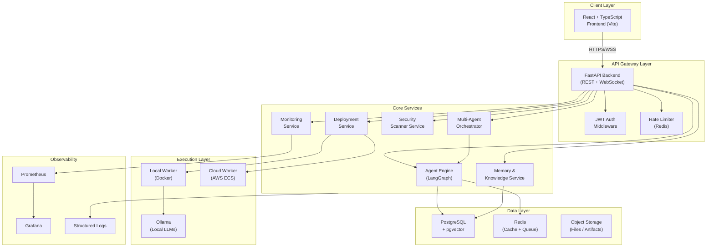

# AgentX AI — System Architecture

## 1. High-Level Architecture



## 2. Directory Structure

```
agentx-ai/
├── backend/
│   ├── app/
│   │   ├── main.py                    # FastAPI app entrypoint
│   │   ├── config.py                  # Settings (pydantic-settings)
│   │   ├── database.py                # SQLAlchemy engine + session
│   │   ├── dependencies.py            # FastAPI DI helpers
│   │   │
│   │   ├── auth/
│   │   │   ├── router.py              # /auth endpoints
│   │   │   ├── service.py             # Auth business logic
│   │   │   ├── models.py              # User, Token DB models
│   │   │   ├── schemas.py             # Pydantic request/response
│   │   │   └── security.py            # JWT, password hashing
│   │   │
│   │   ├── organizations/
│   │   │   ├── router.py
│   │   │   ├── service.py
│   │   │   ├── models.py
│   │   │   └── schemas.py
│   │   │
│   │   ├── agents/
│   │   │   ├── router.py
│   │   │   ├── service.py
│   │   │   ├── models.py
│   │   │   ├── schemas.py
│   │   │   └── engine/
│   │   │       ├── executor.py        # LangGraph agent execution
│   │   │       ├── tools.py           # Tool registry
│   │   │       └── state.py           # Agent state management
│   │   │
│   │   ├── workflows/
│   │   │   ├── router.py
│   │   │   ├── service.py
│   │   │   ├── models.py
│   │   │   └── schemas.py
│   │   │
│   │   ├── deployments/
│   │   │   ├── router.py
│   │   │   ├── service.py
│   │   │   ├── models.py
│   │   │   └── schemas.py
│   │   │
│   │   ├── memory/
│   │   │   ├── service.py
│   │   │   └── vector_store.py
│   │   │
│   │   ├── security_scanner/
│   │   │   ├── router.py
│   │   │   ├── service.py
│   │   │   └── schemas.py
│   │   │
│   │   ├── monitoring/
│   │   │   ├── router.py
│   │   │   ├── service.py
│   │   │   └── metrics.py
│   │   │
│   │   ├── credentials/
│   │   │   ├── router.py
│   │   │   ├── service.py
│   │   │   ├── models.py
│   │   │   └── schemas.py
│   │   │
│   │   ├── knowledge/
│   │   │   ├── router.py
│   │   │   ├── service.py
│   │   │   ├── models.py
│   │   │   └── schemas.py
│   │   │
│   │   ├── audit/
│   │   │   ├── service.py
│   │   │   └── models.py
│   │   │
│   │   └── common/
│   │       ├── exceptions.py
│   │       ├── pagination.py
│   │       └── utils.py
│   │
│   ├── migrations/                    # Alembic migrations
│   │   └── versions/
│   ├── tests/
│   │   ├── conftest.py
│   │   ├── test_auth.py
│   │   ├── test_agents.py
│   │   └── test_workflows.py
│   ├── Dockerfile
│   ├── requirements.txt
│   ├── alembic.ini
│   └── .env.example
│
├── frontend/
│   ├── src/
│   │   ├── main.tsx
│   │   ├── App.tsx
│   │   ├── api/                       # API client (axios + react-query)
│   │   ├── components/
│   │   │   ├── ui/                    # Shared design system components
│   │   │   ├── layout/                # Sidebar, Header, Shell
│   │   │   └── agents/                # Agent-specific components
│   │   ├── pages/
│   │   │   ├── Dashboard.tsx
│   │   │   ├── Agents.tsx
│   │   │   ├── AgentBuilder.tsx
│   │   │   ├── Workflows.tsx
│   │   │   ├── Deployments.tsx
│   │   │   ├── KnowledgeBase.tsx
│   │   │   ├── Cybersecurity.tsx
│   │   │   ├── Monitoring.tsx
│   │   │   ├── Settings.tsx
│   │   │   └── Organization.tsx
│   │   ├── hooks/                     # Custom React hooks
│   │   ├── stores/                    # Zustand state stores
│   │   ├── types/                     # TypeScript interfaces
│   │   └── utils/
│   ├── public/
│   ├── index.html
│   ├── vite.config.ts
│   ├── tailwind.config.ts
│   ├── tsconfig.json
│   └── package.json
│
├── worker/                            # Standalone execution worker
│   ├── main.py
│   ├── executor.py
│   ├── Dockerfile
│   └── requirements.txt
│
├── infrastructure/
│   ├── docker-compose.yml             # Local full-stack
│   ├── docker-compose.dev.yml         # Dev override
│   ├── prometheus/
│   │   └── prometheus.yml
│   └── grafana/
│       └── dashboards/
│
├── docs/
│   ├── README.md
│   ├── ARCHITECTURE.md
│   ├── API.md
│   ├── SECURITY.md
│   └── DEPLOYMENT.md
│
├── .github/
│   └── workflows/
│       ├── ci.yml
│       └── deploy.yml
│
└── .env.example
```

## 3. Technology Decisions

| Layer | Technology | Rationale |
|---|---|---|
| Frontend | React 18, TypeScript, Vite, Tailwind CSS | Type safety, fast HMR, utility-first styling |
| State Mgmt | Zustand + TanStack Query | Lightweight global store + server-state caching |
| Backend | Python 3.11, FastAPI, Pydantic v2 | Async-first, automatic OpenAPI docs, strict validation |
| ORM | SQLAlchemy 2.0 (async) + Alembic | Async queries, managed schema migrations |
| Agent Engine | LangGraph 0.2.x | Stateful graph-based agent orchestration |
| LLM Abstraction | LangChain core (ChatOpenAI, ChatOllama) | Multi-provider support with unified interface |
| Primary DB | PostgreSQL 16 + pgvector | Relational + vector search in one database |
| Cache / Queue | Redis 7 | Session store, rate-limiting, task queuing |
| Auth | JWT (python-jose) + bcrypt | Stateless tokens, secure password storage |
| Encryption | Fernet (cryptography lib) | Credential encryption at rest |
| Container | Docker + Docker Compose | Reproducible local and CI environments |
| Monitoring | Prometheus + Grafana | Industry standard metrics pipeline |
| Testing | pytest + pytest-asyncio + httpx | Async-compatible API and unit tests |

## 4. Database Schema

### Core Tables

```
users
  id UUID PK
  email VARCHAR UNIQUE NOT NULL
  hashed_password VARCHAR NOT NULL
  full_name VARCHAR
  is_active BOOLEAN DEFAULT true
  is_verified BOOLEAN DEFAULT false
  created_at TIMESTAMP
  updated_at TIMESTAMP

organizations
  id UUID PK
  name VARCHAR NOT NULL
  slug VARCHAR UNIQUE NOT NULL
  plan VARCHAR DEFAULT 'free'
  created_at TIMESTAMP

org_memberships
  id UUID PK
  org_id UUID FK organizations.id
  user_id UUID FK users.id
  role VARCHAR (owner|admin|member|viewer)
  created_at TIMESTAMP

agents
  id UUID PK
  org_id UUID FK organizations.id
  created_by UUID FK users.id
  name VARCHAR NOT NULL
  description TEXT
  system_prompt TEXT
  model_provider VARCHAR
  model_name VARCHAR
  temperature FLOAT DEFAULT 0.7
  max_tokens INTEGER
  is_active BOOLEAN DEFAULT true
  version INTEGER DEFAULT 1
  created_at TIMESTAMP
  updated_at TIMESTAMP

agent_tools
  id UUID PK
  agent_id UUID FK agents.id
  tool_name VARCHAR NOT NULL
  config JSONB

workflows
  id UUID PK
  org_id UUID FK organizations.id
  created_by UUID FK users.id
  name VARCHAR NOT NULL
  description TEXT
  graph_definition JSONB
  is_active BOOLEAN DEFAULT true
  created_at TIMESTAMP

executions
  id UUID PK
  org_id UUID FK organizations.id
  agent_id UUID FK agents.id NULLABLE
  workflow_id UUID FK workflows.id NULLABLE
  initiated_by UUID FK users.id
  status VARCHAR (pending|running|completed|failed|cancelled)
  input JSONB
  output JSONB
  error TEXT
  tokens_used INTEGER DEFAULT 0
  cost_usd FLOAT DEFAULT 0.0
  started_at TIMESTAMP
  completed_at TIMESTAMP
  created_at TIMESTAMP

deployments
  id UUID PK
  org_id UUID FK organizations.id
  agent_id UUID FK agents.id
  environment VARCHAR (local|cloud)
  runtime_node_id UUID FK runtime_nodes.id NULLABLE
  status VARCHAR (pending|running|stopped|error)
  config JSONB
  created_at TIMESTAMP
  updated_at TIMESTAMP

runtime_nodes
  id UUID PK
  org_id UUID FK organizations.id
  name VARCHAR NOT NULL
  node_type VARCHAR (local|cloud)
  endpoint VARCHAR
  api_key_hash VARCHAR
  status VARCHAR (online|offline|unknown)
  last_heartbeat TIMESTAMP
  metadata JSONB
  created_at TIMESTAMP

credentials
  id UUID PK
  org_id UUID FK organizations.id
  name VARCHAR NOT NULL
  credential_type VARCHAR
  encrypted_value TEXT NOT NULL
  created_by UUID FK users.id
  created_at TIMESTAMP

knowledge_documents
  id UUID PK
  org_id UUID FK organizations.id
  name VARCHAR NOT NULL
  content_type VARCHAR
  chunk_count INTEGER
  created_by UUID FK users.id
  created_at TIMESTAMP

knowledge_chunks
  id UUID PK
  document_id UUID FK knowledge_documents.id
  chunk_index INTEGER
  content TEXT
  embedding VECTOR(1536)
  metadata JSONB

audit_logs
  id UUID PK
  org_id UUID FK organizations.id
  user_id UUID FK users.id NULLABLE
  action VARCHAR NOT NULL
  resource_type VARCHAR
  resource_id UUID
  details JSONB
  ip_address VARCHAR
  created_at TIMESTAMP

api_keys
  id UUID PK
  org_id UUID FK organizations.id
  created_by UUID FK users.id
  name VARCHAR NOT NULL
  key_hash VARCHAR NOT NULL
  prefix VARCHAR NOT NULL
  scopes JSONB
  last_used_at TIMESTAMP
  expires_at TIMESTAMP NULLABLE
  is_active BOOLEAN DEFAULT true
  created_at TIMESTAMP
```

## 5. API Design

### Authentication
```
POST   /api/v1/auth/register
POST   /api/v1/auth/login
POST   /api/v1/auth/refresh
POST   /api/v1/auth/logout
GET    /api/v1/auth/me
```

### Organizations
```
POST   /api/v1/organizations
GET    /api/v1/organizations/{org_id}
PATCH  /api/v1/organizations/{org_id}
GET    /api/v1/organizations/{org_id}/members
POST   /api/v1/organizations/{org_id}/members/invite
DELETE /api/v1/organizations/{org_id}/members/{user_id}
```

### Agents
```
GET    /api/v1/agents
POST   /api/v1/agents
GET    /api/v1/agents/{agent_id}
PATCH  /api/v1/agents/{agent_id}
DELETE /api/v1/agents/{agent_id}
POST   /api/v1/agents/{agent_id}/duplicate
POST   /api/v1/agents/{agent_id}/execute
GET    /api/v1/agents/{agent_id}/executions
```

### Workflows
```
GET    /api/v1/workflows
POST   /api/v1/workflows
GET    /api/v1/workflows/{workflow_id}
PATCH  /api/v1/workflows/{workflow_id}
DELETE /api/v1/workflows/{workflow_id}
POST   /api/v1/workflows/{workflow_id}/execute
```

### Executions
```
GET    /api/v1/executions
GET    /api/v1/executions/{execution_id}
POST   /api/v1/executions/{execution_id}/cancel
GET    /api/v1/executions/{execution_id}/stream  (SSE)
```

### Deployments
```
GET    /api/v1/deployments
POST   /api/v1/deployments
GET    /api/v1/deployments/{deployment_id}
POST   /api/v1/deployments/{deployment_id}/start
POST   /api/v1/deployments/{deployment_id}/stop
DELETE /api/v1/deployments/{deployment_id}
```

### Knowledge
```
GET    /api/v1/knowledge/documents
POST   /api/v1/knowledge/documents
DELETE /api/v1/knowledge/documents/{doc_id}
POST   /api/v1/knowledge/search
```

### Monitoring & Dashboard
```
GET    /api/v1/dashboard/stats
GET    /api/v1/monitoring/executions
GET    /api/v1/monitoring/metrics
GET    /api/v1/monitoring/logs
```

### API Keys
```
GET    /api/v1/api-keys
POST   /api/v1/api-keys
DELETE /api/v1/api-keys/{key_id}
```

## 6. Security Architecture

### Layers
1. **Transport** — HTTPS enforced in production, HSTS headers
2. **Authentication** — JWT (HS256, 30min access + 7d refresh) or API key
3. **Authorization** — RBAC middleware on every protected route; org-scoped queries
4. **Input Validation** — Pydantic models on all inputs; no raw SQL
5. **Secret Storage** — Fernet-encrypted credentials in DB; keys in env
6. **Rate Limiting** — Redis sliding window per user/IP
7. **Audit Logging** — Every write action logged with actor + resource
8. **Agent Sandboxing** — Tool allowlists per agent; no raw shell/filesystem access
9. **Prompt Injection Defense** — Input sanitization; system prompt isolation
10. **Tenant Isolation** — Every query filtered by org_id from token; no cross-org leakage

## 7. Phased Implementation Checklist

### Phase 1 — Foundation ✅ (current)
- [x] Repository + project structure
- [x] Backend: FastAPI app, config, DB setup
- [x] Database migrations (users, orgs, memberships)
- [x] Auth: register, login, JWT, refresh, /me
- [x] RBAC middleware
- [x] Rate limiting (Redis)
- [x] Frontend: Vite + React + Tailwind scaffold
- [x] Auth pages (login, register)
- [x] Dashboard shell with navigation
- [x] Docker Compose for local dev
- [x] pytest foundation + auth tests

### Phase 2 — Agent Engine
- [ ] Model provider abstraction (OpenAI, Ollama)
- [ ] Agent CRUD API + DB models
- [ ] LangGraph executor
- [ ] Tool registry
- [ ] Execution history
- [ ] Agent test panel (frontend)
- [ ] SSE streaming for execution output

### Phase 3 — Multi-Agent & Workflows
- [ ] Workflow CRUD + graph storage
- [ ] Visual workflow editor (ReactFlow)
- [ ] Multi-agent orchestration (LangGraph supervisor)
- [ ] Task delegation between agents
- [ ] Human approval checkpoints

### Phase 4 — Deployment
- [ ] Runtime node registration
- [ ] Local Docker worker
- [ ] Deployment lifecycle (start/stop/restart)
- [ ] Cloud worker (AWS ECS compatible)

### Phase 5 — Cybersecurity Module
- [ ] Security agent configuration
- [ ] Semgrep integration
- [ ] Vulnerability report generation
- [ ] OWASP checklist scoring

### Phase 6 — Monitoring & Observability
- [ ] Prometheus metrics endpoint
- [ ] Grafana dashboard provisioning
- [ ] Usage tracking + cost estimation
- [ ] Structured logging pipeline

### Phase 7 — SaaS Hardening
- [ ] Quota enforcement
- [ ] Organization billing hooks
- [ ] API key scopes
- [ ] Production Docker + CI/CD pipeline
